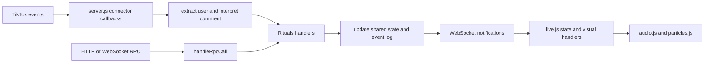

# Current interaction flow

The app runs one Bun backend that owns the TikTok connection, interaction rules, live state, persistence, and JSON-RPC. It sends state snapshots and event notifications over WebSocket. The browser stage turns those notifications into scene updates, animation, and sound. The Tauri app starts this same backend, so it does not have a separate TikTok event path.

`connectTikTokLive()` subscribes to chat, likes, follows, shares, social events, gifts, and members. `extractUserFromEvent()` turns TikTok payloads into a viewer name, ID, and avatar. Chat goes through `handleViewerComment()` and `parseViewerComment()`, which sanitize text, apply a per-viewer cooldown, and choose a temple action from keywords. Accepted comments that match no keyword default to an incense ritual. Likes are capped per connector event, and gift combo counts are reduced before the gift handler runs.

TikTok callbacks and RPC calls converge on the same `Rituals` methods. Those methods mutate the singleton state, record a typed event, and broadcast `temple.event` with the event and current public state. `handleRpcCall()` exposes the same actions through HTTP `POST /rpc` and WebSocket `/ws`. A new WebSocket client receives an initial `temple.state` snapshot.

`public/js/live.js` consumes snapshots and events. `updateUIState()` updates counters and participant views. `triggerRitualVisuals()` maps temple event types to animations and audio. `public/index.html` and `public/css/live.css` define one fixed 1080×1920 temple stage; `audio.js` and `particles.js` own browser sound and effects. `public/admin.html` contains operator controls. Tauri starts the same backend and serves its local UI.

The repo has no generic interaction event model or mode selection. TikTok callbacks route directly to temple rituals, and the browser expects temple-specific event types. Backend state and frontend rendering therefore need coordinated changes for a wedding mode. Follow and share callbacks coexist with a `SOCIAL` handler, so the wedding plan needs a single deduplication point before counting social actions.

Grounding sources: `server.js`, `public/index.html`, `public/css/live.css`, `public/js/live.js`, `public/js/audio.js`, `public/js/particles.js`, `public/admin.html`, `src-tauri/src/runtime.rs`, `README.md`, `PRODUCT.md`, and `docs/superpowers/specs/2026-10-31-tiktok-live-temple-rpc-design.md`.
