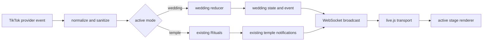

# Virtual wedding mode plan

> Superseded: the user clarified that Wedding must ship as a separate application and binary, independent of the prayer feature. This draft described an in-temple mode and is retained only as the record of the earlier plan. The standalone app boundary and interaction shape are documented in [Virtual Wedding Live architecture](../../../apps/virtual-wedding/ARCHITECTURE.md).

## Problem

The user wants a TikTok Live wedding scene like the supplied screenshot, built on the current TikTok event connection. The app already receives comments, likes, follows, shares, gifts, and member joins. It maps comments, likes, social events, and gifts to Buddhist rituals, while member joins update the temple guest totals. The browser stage also renders only temple events. Wedding mode needs its own rules, state, and scene while keeping the existing local server, TikTok connection, JSON-RPC, WebSocket, OBS, and Tauri runtime.

## Current flow

`server.js` connects to TikTok and sends provider events straight to `Rituals`. The ritual handlers update one shared state object and broadcast `temple.event` with the event and public state. HTTP `POST /rpc` and WebSocket `/ws` use the same JSON-RPC dispatcher. A new WebSocket client gets a `temple.state` snapshot.

`public/js/live.js` reads those messages and updates the temple scene. Its `triggerRitualVisuals()` switch maps temple event types to animation and audio. `public/index.html` and `public/css/live.css` define the 1080×1920 stage. `public/js/audio.js` and `public/js/particles.js` own shared browser effects. `public/admin.html` controls the server. Tauri starts the same backend, and OBS uses the same local server.

TikTok callbacks currently bypass a shared interaction type. `parseViewerComment()` also turns an accepted comment with no known keyword into an incense ritual. Wedding mode needs explicit comment commands so an ordinary wedding chat message cannot trigger a temple action. The follow and share handlers also coexist with a `SOCIAL` handler, so the wedding event path needs one place to prevent duplicate cheers.

## Usage

The operator selects Wedding in `/admin`, opens a lobby, and connects the TikTok room through the existing `live.connect` command. Temple remains the default mode after a backend restart.

```js
await callRpc('live.setMode', { mode: 'wedding' });
await callRpc('wedding.open', {});
await callRpc('live.connect', { username: '@wedding_live' });
```

If chat does not fill both roles, the operator sets the missing participant and locks the couple.

```js
await callRpc('wedding.assignRole', { role: 'bride', name: 'Mai Anh' });
await callRpc('wedding.lockCouple', {});
```

During the lobby, viewers comment `#codau` or `#chure` to claim an open role. The host can replace a claim and locks the couple before the ceremony. The host can enter names in the admin page when no viewers claim the roles.

During the ceremony, viewers comment `#loichuc <message>` to send a wish. Likes fill a shared celebration meter. Follows and shares add guest cheers. Gifts trigger flower or confetti effects. The host advances the ceremony and ends or cancels it. Gifts never unlock a phase or decide the couple.

The stage shows the same active mode in the app browser and in OBS. The initial state snapshot restores the current wedding scene after a browser reload without replaying old animations.

The admin simulator sends the same normalized comment to the wedding reducer without a TikTok connection.

```js
await callRpc('wedding.simulate', {
  kind: 'comment',
  viewer: { id: 'viewer_7', name: 'Ngọc', avatar: '' },
  text: '#loichuc Chúc hai bạn trăm năm hạnh phúc'
});
```

## Shape

Add a server-owned active mode and a separate, in-memory wedding state. Keep the current `Rituals` implementation in `server.js` for this first mode. Normalize TikTok events at the connector boundary, then send them to either the existing Temple path or the wedding reducer. Do not add a general plugin registry for two modes. This treats multiple modes as a day-one assumption, per Redesign from First Principles. Define the interaction and state shapes before handlers, per Foundational Thinking.

```ts
type ActiveMode = 'temple' | 'wedding';
type Viewer = { id: string; name: string; avatar: string };
type Participant = { id: string | null; name: string; avatar: string };
type PublicViewer = Pick<Viewer, 'name' | 'avatar'>;

type TikTokInteraction =
  | { kind: 'comment'; viewer: Viewer; text: string }
  | { kind: 'like'; viewer: Viewer; count: number }
  | { kind: 'follow' | 'share' | 'member'; viewer: Viewer }
  | { kind: 'gift'; viewer: Viewer; name: string; coins: number; count: number };

type WeddingPhase = 'closed' | 'lobby' | 'vows' | 'rings' | 'celebration' | 'ended';
type WeddingEndReason = 'completed' | 'cancelled' | null;
type WeddingRole =
  | { source: 'viewer'; participant: Participant; claimedAt: number }
  | { source: 'host'; participant: Participant }
  | null;
type WeddingState = {
  phase: WeddingPhase;
  endReason: WeddingEndReason;
  couple: { bride: WeddingRole; groom: WeddingRole; locked: boolean };
  progress: number; // 0 through 100. The host still controls phase changes.
  recentGuests: Viewer[]; // Keep at most 40 distinct IDs for the stage rows.
  totals: { likes: number; follows: number; shares: number; gifts: number };
  recentWishes: Array<{ viewer: Viewer; text: string; receivedAt: number }>;
};

type WeddingEvent =
  | { type: 'roleClaimed'; role: 'bride' | 'groom'; participant: PublicViewer }
  | { type: 'roleAssigned'; role: 'bride' | 'groom'; participant: PublicViewer }
  | { type: 'wishReceived'; viewer: PublicViewer; text: string }
  | { type: 'cheer'; source: 'like' | 'follow' | 'share'; count: number }
  | { type: 'giftCelebration'; viewer: PublicViewer; name: string; coins: number }
  | { type: 'phaseChanged'; phase: WeddingPhase }
  | { type: 'ended'; reason: Exclude<WeddingEndReason, null> };

type WeddingCommand =
  | { kind: 'open' }
  | { kind: 'assignRole'; role: 'bride' | 'groom'; name: string; avatar?: string }
  | { kind: 'lockCouple' }
  | { kind: 'advance'; expectedPhase: WeddingPhase; targetPhase: WeddingPhase }
  | { kind: 'simulateInteraction'; interaction: TikTokInteraction }
  | { kind: 'finish' }
  | { kind: 'cancel' };

type WeddingResult = { state: WeddingState; events: WeddingEvent[] };
type PublicWeddingRole = Pick<Participant, 'name' | 'avatar'> | null;
type PublicWeddingState = Omit<WeddingState, 'couple' | 'recentGuests' | 'recentWishes'> & {
  couple: { bride: PublicWeddingRole; groom: PublicWeddingRole; locked: boolean };
  guests: PublicViewer[];
  recentWishes: Array<{ viewer: PublicViewer; text: string; receivedAt: number }>;
};
```

These are conceptual TypeScript-like contracts for the existing JavaScript code. The `WeddingPhase` union encodes the ceremony lifecycle, per Model the Domain. `server.js` owns `activeMode` and selects the handler. `server/modes/wedding.js` owns wedding state transitions, command checks, progress caps, a bounded guest roster, a bounded wish list, and the public wedding snapshot. The module does not import TikTok or JSON-RPC types. Parse raw TikTok payloads and RPC parameters at the boundary, then let the reducer trust `TikTokInteraction` and `WeddingCommand`. This applies Boundary Discipline. `PublicWeddingState` sends only display names and avatars for guests and role holders.

The core functions are small and pure where possible:

```ts
function normalizeTikTokEvent(raw: unknown): TikTokInteraction | null;
function routeTikTokInteraction(input: TikTokInteraction): ModeResult;
function reduceWeddingInteraction(state: WeddingState, input: TikTokInteraction): WeddingResult;
function applyWeddingCommand(state: WeddingState, command: WeddingCommand): WeddingResult;
function getWeddingPublicState(state: WeddingState): PublicWeddingState;
```

The server is the only writer of active mode and wedding state. Each reducer call returns the next state and events; the server stores that state and broadcasts the result. Role claims are accepted only in the lobby, one role per viewer. The host can replace a claim with `wedding.assignRole` and locks the couple before the ceremony. Wishes use the existing text sanitizer and per-viewer cooldown, then enter a bounded queue. Parse command prefixes after text normalization, then sanitize the extracted wish body. Unknown comments do nothing in Wedding mode. Likes update progress in batches. A host command advances each phase, so a burst of likes cannot skip the vows. Gifts create visual events without adding progress. Keep wish text in the on-screen feed instead of reading every wish aloud, so busy chat does not fill the speech queue.

This follows Experience First. Wishes and likes give viewers a visible way to shape the ceremony. Gift value changes the celebration effect, while the host controls the ceremony pace.

Use one explicit interaction table for both `wedding.simulate` and the TikTok adapter. Both call the same reducer, so the admin simulation remains a useful check instead of a second implementation of wedding rules. This follows Build the Lever.

| Input | Rule | Stage response |
| --- | --- | --- |
| `#codau` or `#chure` during the lobby | Record one role claim per viewer. The host can replace claims and lock the couple. | Fill the bride or groom name and avatar slots. |
| `#loichuc <message>` during vows or rings | Sanitize the message, apply the viewer cooldown, and keep only a bounded queue. | Show the wish in a short-lived card. |
| Likes | Add the capped event count to progress. | Update the shared affection meter and play a batched heart effect. |
| Member join | Add the viewer once to the bounded guest roster. | Fill a guest row with the viewer name and avatar. |
| Follow or share | Deduplicate the callback before recording one cheer. | Show a brief guest cheer. |
| Gift | Use the connector's combo delta and gift value. Do not add ceremony progress. | Show flowers or confetti and name the gift sender. |
| Host phase command | Check the expected current phase and allowed target phase. | Change the ceremony chapter. |

The prompt cards show the exact comments viewers can send. Viewers take part by posting those comments in TikTok chat.

Keep `temple.*` RPC method names and `temple.event` payloads unchanged. Add an `activeMode` field to the current state snapshot. Add `wedding.*` commands and `wedding.state` and `wedding.event` notifications. The server sends the wedding snapshot when a browser connects and after each wedding state change. A mode-specific RPC command returns a clear mode error when its mode is inactive. Repeating `live.setMode` with the current mode is a no-op. `wedding.open` returns the open lobby without clearing it. Opening after `ended` starts a new lobby. `wedding.advance` includes the expected current phase, so a retried command cannot skip a chapter. `wedding.finish` and `wedding.cancel` are safe to repeat. These guards make retries safe, per Make Operations Idempotent. `live.setMode` works only while TikTok is disconnected and the wedding phase is `closed` or `ended`, so the Tauri window, admin page, and OBS source always share one scene. Wedding state resets after a backend restart; Temple remains the default.

The stage keeps its 9:16 scale and OBS layout. `public/js/live.js` keeps the WebSocket and RPC transport, then dispatches snapshots and events to the active renderer. Add `public/js/wedding.js` with a small mount, update, event, and dispose interface. Pass the shared audio and particle services into the renderer instead of exposing temple DOM IDs. Add a wedding stage root in `public/index.html` and wedding rules in `public/css/wedding.css`.

Use the screenshot's layout cues. Place the couple at center stage, build a visible aisle, arrange guests along the sides, and place the current wish and concise comment prompts near the lower edge. Keep names and wishes in a small bounded feed so the stage remains readable. Use a distinct wedding palette and wedding art. Do not reuse Buddhist figures or temple sound cues as wedding assets. Start with placeholder artwork and replace it after the interaction loop works.

The event flow is:



## Implementation sequence and checks

1. Define the interaction, phase, command, and event shapes in `server/modes/wedding.js`. Add a simulation path that calls the same reducer as TikTok events. Check role claims, host locking, phase order, wish limits, duplicate commands, replayed phase commands, and progress caps without a TikTok room.
2. Add `activeMode`, `live.setMode`, wedding RPC methods, and wedding WebSocket messages. Keep Temple selected by default. Check that the mode switch fails while TikTok is connected, every browser receives the same mode, and existing Temple RPC and notification behavior stays intact.
3. Normalize TikTok events and route them by active mode. Preserve gift combo deltas, cap like batches, and deduplicate follow or share events before they update wedding state. Check that one provider action produces at most one wedding event, and that an ordinary comment cannot trigger incense.
4. Add the wedding renderer, stage root, and CSS. First use placeholder art. Check the lobby, vows, rings, celebration, and ended phases at 1080×1920, after a browser reload, and in `/?obs=1`. Check empty chat, busy chat, long names, long wishes, and muted audio.
5. Add admin controls for mode selection, role review, phase changes, simulation, and ending or cancelling a wedding. Check that the same commands work in the Tauri webview and OBS source. Update `README.md`, `PRODUCT.md`, and the RPC design spec, then check both Tauri resource configurations include the new public files.

Each step ends with a visible check before the next starts, per Sequence Work into Verifiable Units. This keeps a failure near the code that caused it.

## Synthesis decision

The incremental active-mode adapter was selected as the base. It scored 5, 4, 5, 5, and 5 against the shared criteria for TikTok and runtime reuse, domain isolation, event flow, shared mode state, and staged checks. The isolated mode-module candidate scored 4, 5, 5, 5, and 3. It offered stronger isolation, but it moved all Temple logic and replaced the current `temple.state` and `temple.event` notifications before Wedding could ship. That adds a migration without helping the first wedding slice.

The synthesis keeps the selected candidate's single connector, shared transports, separate wedding state, and Temple compatibility. It takes the isolated candidate's independent renderer contract, bounded session data, initial-snapshot recovery, and gift-independent progression. The mode router is intentionally specific to Temple and Wedding. A third mode can justify a shared module coordinator later. No cross-judge ran because the supplied model routing maps every architect runner and judge to `inherit-parent`, while the arena requires a judge from a different model family.

## Tradeoffs accepted

- We accept one active mode per local TikTok room in exchange for one predictable OBS scene across every browser client.
- We accept host-confirmed couple roles in exchange for viewer role claims without letting chat start or cancel the ceremony.
- We accept in-memory wedding state that resets after a crash in exchange for avoiding a stale ceremony resuming on the next stream.
- We accept a small mode branch in `server.js` and `live.js` in exchange for keeping the connector, transports, and Tauri packaging shared.
- We accept visual gift effects that do not advance the ceremony in exchange for a complete path for viewers who do not send gifts.

## Alternatives considered

One isolated module per mode with a generic coordinator would make a third scene easier to add. It would also require moving the existing Temple state and rituals and changing the documented Temple notification contract before Wedding works. That migration exposes more work to the current operators and maintainers than this mode needs.

A separate wedding process or server entry point would isolate the code, but it would duplicate the TikTok connection, admin connection control, WebSocket path, and Tauri shutdown flow. A single active-mode adapter keeps those pieces in one place.

## Implementation reconciliation

No implementation has started. Keep the current Temple event names and behavior when Temple is active. If implementation changes the notification contract or moves Temple state, update this plan and record why that change is required before closing the affected phase.

## Open decisions and risks

This plan uses viewer role claims with host confirmation. The admin page provides name fields as a fallback when chat is quiet. If the first release should use host-assigned roles only, the state shape can keep the same couple slots and skip role-claim handling.

The current code has direct follow and share handlers plus a `SOCIAL` handler. Verify the connector's event behavior before choosing deduplication keys. Do not count each callback as a separate guest cheer without that check.

The first stage uses placeholder art. Replace it with original wedding art after the stage layout and interaction flow work. `src-tauri/tauri.conf.json` and `src-tauri/tauri.windows.conf.json` both include the `public/` directory, but the packaged app still needs a smoke check after new files land.

## Next implementation step

Add the wedding state reducer and a simulation command, then verify the lobby, role claims, wishes, and phase transitions without a live TikTok room.
